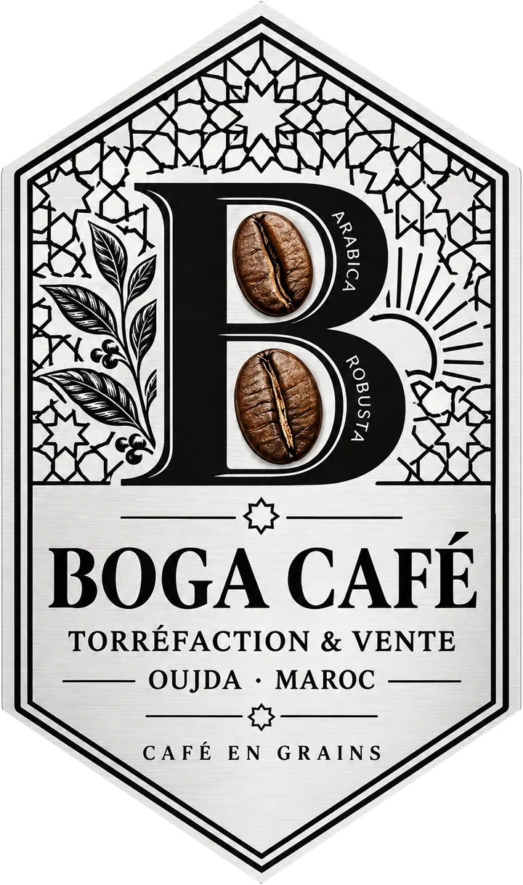
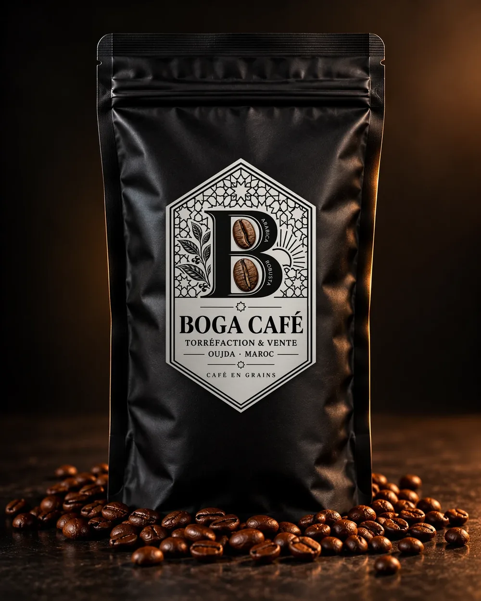
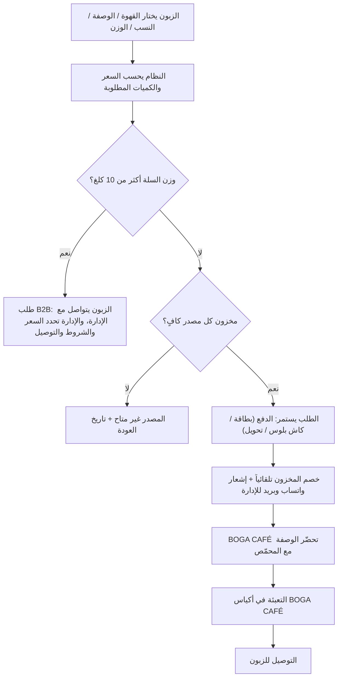

<p align="center">
  
</p>

<h1 align="center">BOGA CAFÉ</h1>

<p align="center">
  <strong>Torréfaction & vente · Oujda, Maroc</strong><br />
  Café en grains · Café doux, sensationnel et savoureux
</p>

<p align="center">
  الموقع الرسمي لعلامة القهوة <strong>BOGA CAFÉ</strong>: واجهة العلامة، متجر إلكتروني لقهوة الحبوب،<br />
  نظام الخلطة الخاصة (Custom Blend)، قسم المهنيين B2B / HORECA، ولوحة إدارة كاملة.<br />
  بثلاث لغات: العربية · Français · English
</p>

---

## المحتويات

1. [فكرة المشروع](#1-فكرة-المشروع)
2. [الزبائن](#2-الزبائن)
3. [المنتجات](#3-المنتجات)
4. [الخلطة الخاصة Custom Blend](#4-الخلطة-الخاصة-custom-blend)
5. [المهنيون B2B / HORECA](#5-المهنيون-b2b--horeca)
6. [الطلب، الدفع، التوصيل، الإشعارات](#6-الطلب-الدفع-التوصيل-الإشعارات)
7. [مسار الطلب من البداية للنهاية](#7-مسار-الطلب-من-البداية-للنهاية)
8. [صفحات الموقع](#8-صفحات-الموقع)
9. [لوحة الإدارة والصلاحيات](#9-لوحة-الإدارة-والصلاحيات)
10. [حالة المشروع وخارطة الطريق](#10-حالة-المشروع-وخارطة-الطريق)
11. [التقنيات](#11-التقنيات)
12. [تنظيم الكود](#12-تنظيم-الكود)
13. [التشغيل والتجربة](#13-التشغيل-والتجربة)
14. [الخدمات الخارجية](#14-الخدمات-الخارجية)
15. [الوثائق التفصيلية](#15-الوثائق-التفصيلية)
16. [En bref · In short](#16-en-bref--in-short)

---

## 1. فكرة المشروع

**BOGA CAFÉ علامة قهوة مغربية من وجدة** هدفها بيع القهوة تحت اسمها وهويتها.

- **BOGA CAFÉ تحدد** الوصفات، الخلطات، النسب، ومواصفات كل منتج.
- **المحمّص / المصنع الشريك** يحمّص وينتج القهوة حسب هذه المواصفات بالضبط.
- القهوة تُعبّأ في **أكياس BOGA CAFÉ** (الكيس الأسود بالملصق الفضي السداسي) وتُباع تحت العلامة.
- الموقع هو **الحضور الرسمي الكامل** للعلامة على الإنترنت: الهوية، عرض المنتجات، البيع، B2B، التواصل، الشبكات الاجتماعية، ولوحة الإدارة.

<p align="center">
  
</p>

> **الرؤية:** موقع واحد رسمي يمثل العلامة، ويعمل في نفس الوقت كمتجر إلكتروني ونظام للزبائن العاديين والمهنيين.
> العلامة + المنتجات + Single Origin + Custom Blend + B2B/HORECA + 3 خلطات B2B (عيّنات مدفوعة 250/500 غ) + الطلبات + الدفع + التوصيل + المخزون + إشعارات واتساب والبريد + الشبكات الاجتماعية + لوحة الإدارة.

## 2. الزبائن

| النوع | من هو | كيف يشتري |
|---|---|---|
| **B2C** | زبون عادي | يطلب عبر الموقع ويدفع مباشرة، حتى 10 كلغ |
| **B2B** | مقهى، فندق، مطعم، شركة، **أو أي شخص يطلب أكثر من 10 كلغ** | يتواصل مع الإدارة التي تحدد السعر النهائي حسب الكمية والمسافة والمدينة والشروط |

## 3. المنتجات

- **حبوب كاملة فقط** (لا توجد قهوة مطحونة).
- **الأحجام:** 250 غ · 500 غ · 1 كلغ.
- **معلومات كل منتج:** نسبة أرابيكا ونسبة روبوستا، درجة التحميص، النكهات، المصدر، الوزن، السعر.
- **لكل وصفة / خلطة سعرها الخاص** لكل حجم.
- **ثلاثة أنواع من المنتجات:**
  - **الخلطات المميزة** (Signature blends) للجميع.
  - **Single Origin:** قهوة من مصدر واحد حسب التوفر.
  - **خلطات B2B الثلاث** (HORECA) الظاهرة للجميع.
- **المخزون يُحسب بالكيلوغرام، مستقل لكل مصدر** (البرازيل، هندوراس، فيتنام…)، ويُخصم تلقائياً مع كل طلب.

## 4. الخلطة الخاصة Custom Blend

الزبون يركّب وصفته بحرية كاملة:

1. يختار **أنواع القهوة**.
2. يحدد **نسبة كل نوع**، ويجب أن يكون **المجموع 100%**.
3. يختار **الوزن**: 250 غ أو 500 غ أو 1 كلغ.

الموقع **يحسب السعر مباشرة** حسب المكونات والنسب والوزن، ويعرض الغرامات لكل مصدر.

**مرتبطة بالمخزون.** مثال لكيس 1 كلغ:

| المصدر | النسبة | الكمية المخصومة من مخزونه |
|---|---|---|
| كولومبيا | 50% | 500 غ |
| البرازيل | 30% | 300 غ |
| روبوستا | 20% | 200 غ |

- إذا لم يكفِ مخزون مصدر ما، **يُمنع استعماله** في الخلطة ويظهر **تاريخ العودة المتوقع**.
- **الزبون لا يختار درجة التحميص**: كل مصدر يُحمّص بدرجته المرجعية، وأي طلب تعديل يمر عبر الإدارة.
- BOGA CAFÉ تعيد إنتاج الوصفة كما اختارها الزبون.

## 5. المهنيون B2B / HORECA

- **3 خلطات B2B** لكل واحدة وصفتها ومعلوماتها وسعرها (الوصفات يمكن أن تتغير مع الوقت).
- **العيّنة مدفوعة (قرار المالك 2026-09-30):** كل خلطة B2B تُباع على الموقع بحجم 250 غ و500 غ كطلب عادي مدفوع. كيس 1 كلغ من خلطات B2B لا يُقبل إلا في سلة تفوق حد B2B (10 كلغ)، فتصبح طلب عرض سعر. لا توجد استمارة عيّنة مجانية.
- **كل طلب يفوق 10 كلغ يصبح B2B** حتى لو كان من شخص عادي: السلة تمنع الدفع، وتقترح التواصل عبر واتساب أو إرسال السلة كطلب يصل للإدارة. الإدارة تحدد السعر النهائي والشروط والتوصيل.

## 6. الطلب، الدفع، التوصيل، الإشعارات

| الموضوع | القاعدة |
|---|---|
| **الدفع** | **لا يوجد دفع عند الاستلام.** الطرق: بطاقة بنكية (CMI)، كاش بلوس، تحويل بنكي، وطرق أخرى يمكن إضافتها مستقبلاً. كل الأموال تصل إلى **الحساب البنكي الرسمي لـ BOGA CAFÉ** |
| **صفحة الدفع** | **صفحة واحدة (One-Page Checkout)**، بدون حاجة لإنشاء حساب. حسابات الزبائن قد تُضاف لاحقاً |
| **التوصيل** | لكل مدن المغرب. التكلفة حسب **المدينة والمسافة والكمية**، وتُحدّد وتُعدّل من لوحة الإدارة |
| **واتساب** | مع كل طلب جديد وكل طلب B2B، تصل الإدارة رسالة واتساب بالمعلومات الأساسية |
| **البريد** | إشعارات على حساب **Gmail** في البداية، وبريد مهني لاحقاً |
| **التواصل** | Instagram · TikTok · Facebook · WhatsApp · Gmail |

## 7. مسار الطلب من البداية للنهاية



## 8. صفحات الموقع

| الصفحة | الرابط | المحتوى |
|---|---|---|
| الرئيسية | `/` | بالترتيب: الفيديو والعنوان، مسارات الشراء، الشريط، «من نحن» (`#about`)، المنتجات المميزة، مصادر القهوة، الخلطة الخاصة (مثال 1 كلغ)، كيف تُحضَّر القهوة، B2B، الشبكات |
| المتجر | `/shop` | كل المنتجات مع تصفية حسب النوع |
| صفحة المنتج | `/product/:slug` | الوصفة بالأعلام، أرابيكا/روبوستا، التحميص، النكهات، الأحجام والأسعار، التوفر |
| أحادي المصدر | `/single-origin` | المصادر وتوفرها |
| الخلطة الخاصة | `/custom-blend` | 3 خطوات + ملخص حي بالسعر والغرامات |
| المهنيون | `/b2b` | الخلطات الثلاث (عيّنة مدفوعة 250/500 غ)، القواعد، تواصل للطلبات الكبيرة |
| السلة | `/cart` | مقياس الوزن حتى 10 كلغ، فحص المخزون، مسار B2B |
| الدفع | `/checkout` | صفحة واحدة: المعلومات، طريقة الدفع، الملخص وتكلفة التوصيل |
| الطلب | `/order/:id` | الدفع، التعليمات، والحالة (من قاعدة البيانات برابط الطلب فالنسخة الحقيقية) |
| اتصل بنا | `/contact` | واتساب، البريد، العنوان، الشبكات |

## 9. لوحة الإدارة والصلاحيات

لوحة الإدارة (`/admin`) هي نظام التسيير المركزي: المنتجات، الخلطات، المخزون، الطلبات، B2B، التوصيل، الدفع، والمحتوى، **بدون تعديل الكود** في العمل اليومي.

> **الوضع الحالي (2026-10-24):** اللوحة الحقيقية خدامة على Supabase فالنسخة `VITE_DATA_MODE=supabase`: دخول بالبريد وكلمة السر + تحقق بخطوتين (TOTP) إجباري فقاعدة البيانات (`aal2`)، وكل الأقسام كتقرا وكتكتب. هادي هي المنشورة دابا على `bogacafe.ma`: المتجر الحقيقي والبيع مسدود (الكتالوج بلا أثمنة ولا زر شراء، و`noindex` مفعّل). النسخة التجريبية (`build:demo`) عندها لوحة على بيانات المتصفح بكلمة سر تجريبية، للتجربة والاختبارات فقط.

| القسم | ما يُدار فيه |
|---|---|
| لوحة القيادة | طلبات جديدة، قيد المعالجة، مكتملة، طلبات B2B المفتوحة، مدفوعات للتحقق، المخزون، المخزون المنخفض، المداخيل |
| الطلبات | معلومات الزبون، المنتجات، **نسب الخلطة والغرامات لكل مصدر**، الوزن، السعر، التوصيل، الدفع، الحالة، السجل |
| طلبات المهنيين | طلبات أكثر من 10 كلغ (السعر النهائي). العيّنات المدفوعة تصل كطلبات عادية |
| المنتجات والخلطات | إضافة، تعديل، إخفاء، حذف · 3 لغات · الوصفة · التحميص · النكهات · الأسعار حسب الحجم |
| المخزون والمصادر | المخزون بالكيلو لكل مصدر، إضافة/خصم مع السبب، سجل الحركات، تفعيل/إيقاف المصدر في الخلطة الخاصة، تاريخ العودة |
| التوصيل | سعر كل مدينة، الكيلوغرامات المشمولة، سعر الكيلو الإضافي، المدة، حاسبة التكلفة |
| المدفوعات | تفعيل الطرق، التعليمات للزبون، الحساب البنكي الرسمي، التحقق من كاش بلوس والتحويلات |
| الإشعارات | رقم واتساب وبريد الإدارة، وسجل الرسائل المرسلة |
| المحتوى | نصوص الموقع بثلاث لغات، روابط التواصل |
| الإعدادات | حد B2B (10 كلغ)، قواعد الخلطة الخاصة، رسوم الكيس، نسبة فقد التحميص، الأدوار والصلاحيات |

| الدور | الوصول |
|---|---|
| **المالك** | كل شيء، وهو وحده من يسجّل الدفع ويغيّر أرقام التواصل ومستلمي الإشعارات و RIB |
| **المسيّر** | كل شيء ما عدا المدفوعات والإعدادات؛ يرى أرقام التواصل ومستلمي الإشعارات دون تغييرها، ويغيّر حد التوصيل المجاني |
| **الموظف** | لوحة القيادة، الطلبات، المهنيون، المخزون (دون تغيير الأسعار) |

## 10. حالة المشروع وخارطة الطريق

| المرحلة | المحتوى | الحالة (2026-10-24) |
|---|---|---|
| 0 | تحضير المعلومات الحقيقية، الحسابات، البنك، طلب CMI | ⏳ عند صاحب المشروع |
| 1 | **النموذج الكامل**: كل الصفحات، الخلطة الخاصة، B2B، الدفع، لوحة الإدارة، 3 لغات، مخطط قاعدة البيانات | ✅ مكتملة |
| 2 | قاعدة البيانات الحقيقية (Supabase)، تسجيل دخول الإدارة + 2FA، الطلبات عبر الخادم | ✅ مكتملة وحية (البيع مسدود بقرار المالك) |
| 3 | الدفع الحقيقي: CMI بالبطاقة، رفع وصل كاش بلوس/التحويل | ⏳ ما بدا ش (الإلغاء الآلي ديال غير المدفوع خدام؛ باقي معلومات المالك والبنك) |
| 4 | الإشعارات الحقيقية: مرسل من الخادم للرسائل اللي كتتسجل فـ `notification_outbox` (شرط قبل فتح البيع) | ⏳ ما مبنيش، معلّق حتى يتوفر عبد الرحيم (Gmail). `api/notify.ts` بقايا Vercel ما منشورة |
| 5 | الصور والنصوص النهائية، الصفحات القانونية، SEO | ⏳ جزئي: الصفحة الرئيسية والهيدر معاد تصميمهم؛ باقي الصور النهائية والقانوني وSEO |
| 6 | الاختبار الكامل والإطلاق | ⏳ |
| 7 | حسابات الزبائن، الفواتير PDF، تتبع دفعات التحميص، تتبع الشحن | ⏳ بعد الإطلاق |

**ثلاث نسخ من نفس الكود (`scripts/build-target.mjs`، `src/data/mode.ts`):**
- **الإنتاج الحالي** (Workers Builds ديال `main`، اللي كيحقن `WORKERS_CI=1`؛ القيم العمومية من `.env.workers-preview`): المتجر الحقيقي على Supabase بقراءة الكتالوج بلا أثمنة (`VITE_SHOWCASE=on`) والبيع مسدود. الأمر المحلي `npm run build` (بلا `VITE_DATA_MODE`) كيبني صفحة «قريباً» وحدها، وهي النسخة الاحتياطية للرجوع؛ `npm run check:real-build` كيتأكد أنها ما فيها حتى حاجة من المتجر.
- **المتجر الحقيقي** (`VITE_DATA_MODE=supabase`): الكتالوج والطلبات والإدارة على Supabase. البيع مسدود فقاعدة البيانات حتى يفتحو المالك.
- **النسخة التجريبية** (`build:demo`): طلبات وزبائن أمثلة، معلومات دفع «DÉMO»، ولوحة بكلمة سر تجريبية، فمتصفح الزائر. للتجربة واختبارات المتصفح فقط.

الحالة المفصّلة والخطوات الجاية: [`PROJECT_STATUS.html`](PROJECT_STATUS.html) و[`PROJECT_NOTES.md`](PROJECT_NOTES.md)، وخطة ما قبل الإطلاق مع تقرير التدقيق: [`docs/12-audit-and-launch-plan.md`](docs/12-audit-and-launch-plan.md).

> **البداية الحقيقية (2026-10-19، محيّنة 2026-10-26):** فقاعدة البيانات الحية، المنتجات العشرة والأصول الستة معروضة (`listed`) بلا ثمن، وغير مفعّلة للبيع (`active` = false) وبلا مخزون؛ والمدن العشرون غير مفعّلة برسوم 0 حتى تتدخل التسعيرة الحقيقية (الوزن المشمول 3 كلغ). 0 طلب و0 طلب B2B. الأثمنة فـ `src/data/seed` أمثلة النموذج والاختبارات فقط.
> **قنوات التواصل حقيقية:** WhatsApp ‎+212 6 09 03 63 78 · bogacafe1@gmail.com · Instagram [@boga.cafe1](https://www.instagram.com/boga.cafe1) · TikTok [@bogacafe795](https://www.tiktok.com/@bogacafe795) · [Facebook](https://www.facebook.com/profile.php?id=61594620729419).

## 11. التقنيات

| الطبقة | التقنية |
|---|---|
| الواجهة | React 19 · TypeScript 7 · Vite 8 · React Router 8 · Node 24 (آخر الإصدارات المستقرة، شتنبر 2026) |
| التصميم | CSS بمتغيرات (tokens) وخصائص منطقية لدعم العربية RTL تلقائياً (استثناء مقصود: قسم الخلطة الخاصة فالرئيسية، النص فيه دايماً على اليسار والشارة على اليمين فكل اللغات) · المتجر بألوان «الكيس الأسود» · حركة هادئة مع السكرول بـ CSS فقط، تحترم إعداد تقليل الحركة |
| اللغات | قواميس TypeScript للعربية والفرنسية والإنجليزية (نسيان ترجمة = المشروع يرفض البناء) |
| منطق الأعمال | `src/core` بـ TypeScript خالص: يعمل فالمتصفح وفدالة الخادم `storefront` بنفس الكود؛ قاعدة البيانات تطبّق نفس القواعد بـ SQL، ومختبر أنهما متطابقان |
| الإنتاج | Supabase: PostgreSQL + أمان على مستوى الصفوف (RLS) + Auth + Storage + Edge Functions |
| الاستضافة | Cloudflare Workers (Workers Builds كينشر `main` أوتوماتيكياً: كل دمج = إصدار). `api/notify.ts` بقايا دالة Vercel ما منشوراش (غادي تتعوض بمرسل من الخادم) |
| الاختبارات | Vitest (390 اختبار فـ 42 ملف) · قاعدة البيانات على PostgreSQL 16 فـ CI و17.11 على live (smoke، pgTAP، تطابق الموقع والقاعدة، سباقات، ضغط الأقفال) · 112 اختبار متصفح (Playwright، Chromium فقط) مع axe لـ WCAG 2.2 A/AA (الفحص الآلي ما كيغطيش كل المعايير) · Oxlint · CI على GitHub Actions. الأرقام ديال 2026-10-24 (`main` `104890d`) |

**الأمان:** فالمتجر الحقيقي، الطلب كيمشي لدالة الخادم `storefront` (Turnstile + حدود)، و**قاعدة البيانات نفسها تعيد حساب كل رقم في الطلب قبل حفظه** (`check_order`: الأسعار، الأحجام، الكميات، الوزن، قاعدة 10 كلغ، التوصيل، طريقة الدفع، المخزون، قواعد الخلطة) وترفض أي طلب لا يطابق؛ وهذا مختبر بطلبات مزوّرة وبـ 42 طلباً يبنيها كود الموقع (فحص التطابق). المخزون يُخصم بعملية ذرّية تمنع بيع نفس الكيلو مرتين، وكل دور لا يرى إلا ما يخصه. **كل حجز للمخزون ينتهي:** الطلب غير المدفوع يُلغى بعد 48 ساعة، والذي أعلن الزبون دفعه ولم يُؤكَّد بعد 120 ساعة (قابلتان للتعديل، ولا يمكن إيقافهما). «لقد دفعت» لا تجعل الطلب مدفوعاً أبداً: **المالك وحده** يسجّل الدفع بعد رؤية المبلغ في الحساب، وهو وحده يلغي طلباً أعلن الزبون دفعه، والطلب المدفوع لا يُلغى إلا بالاسترجاع. البيع مسدود فقاعدة البيانات (`salesOpen`) حتى يفتحو المالك. التفاصيل الحالية: `PROJECT_NOTES.md` (`docs/03-architecture.md` هي البنية الأولى).

## 12. تنظيم الكود

المشروع مقسّم بحيث **يُعدّل كل قسم وحده** دون لمس الأقسام الأخرى.

```
src/
  core/          منطق الأعمال: الأسعار، الخلطة، المخزون، السلة، التوصيل، الطلب + الاختبارات
  data/          البيانات: supabase/ (الحي)، demo/ + seed/ (أمثلة النموذج والاختبارات)، defaults.ts (القيم الافتراضية = ديال القاعدة)
  server/        منطق دالة storefront (يتجمع فـ supabase/functions/storefront)
  coming-soon/   صفحة «قريباً» (النسخة الاحتياطية ديال `npm run build` المحلي، ماشي المنشورة دابا)
  services/      الدفع والإشعارات كمحوّلات قابلة للاستبدال
  i18n/          العربية / الفرنسية / الإنجليزية
  shared/        مكونات مشتركة: الرأس والتذييل، حالة السلة، بطاقة المنتج، صورة المنتج وملصقه، قنوات التواصل
  features/      الأقسام، كل قسم في مجلده
    home/ shop/ product/ single-origin/ custom-blend/ b2b/ cart/ checkout/ contact/
    admin/       dashboard/ orders/ b2b/ products/ stock/ shipping/ payments/ notifications/ content/ settings/
  styles/        الألوان والخطوط
api/             بقايا دالة Vercel للإرسال (ما منشوراش؛ تتعوض بمرسل من الخادم فالمرحلة 4)
tests/           اختبار حدود الأقسام (يفشل إذا اعتمد قسم على داخل قسم آخر)
supabase/        migrations (19 ملف، كلها مطبّقة على live)، manual/ (سكريبتات SQL Editor والاسترجاع)، tests/، functions/
brand/           الشعار المتجهي بكل نسخه، PNG، صور مواقع التواصل، ودليل الاستعمال
docs/            التحليل والدراسة والخطة
```

أين يوجد كل شيء وكيف تعدّله: [`docs/06-modules.md`](docs/06-modules.md).

## 13. التشغيل والتجربة

```bash
npm install
npm run dev          # المتجر محلياً على بيانات المتصفح (كتالوج الأمثلة، بلا إدارة ولا دفع)؛ ماشي الموقع المنشور
npm run dev -- --mode demo   # النموذج التجريبي محلياً: أمثلة، لوحة الإدارة، ومحاكاة الدفع بالبطاقة
npm test             # كل الاختبارات: منطق الأعمال، الإرسال، حدود الأقسام
npm run lint         # فحص الكود (Oxlint): قواعد React، سهولة الاستعمال، الاختبارات
npm run build:e2e && npm run test:e2e   # اختبارات المتصفح: إعدادات الموقع الحقيقي مع البيانات التجريبية (Playwright + axe)
npm run typecheck    # فحص الأنواع (الموقع + دالة الخادم)
npm run build        # محلياً: صفحة «قريباً» (الاحتياطية) ← dist/. Workers Builds ديال `main` كيبني المتجر الحقيقي
npm run check:real-build   # بعد build: الصفحة ما فيها حتى حاجة من المتجر (لا كتالوج، لا أثمنة، لا Supabase)
npm run build:demo   # النموذج في ملف HTML واحد يفتح مباشرة في المتصفح ← dist-demo/index.html
./supabase/tests/run-local.sh   # اختبار قاعدة البيانات (يتطلب PostgreSQL + pgTAP 1.3.2؛ قاعدة اختبار boga_test فقط)
npm run build:functions   # يجمع دالة storefront ← supabase/functions/storefront/dist/index.js (النشر بإذن المالك)
```

**لوحة الإدارة (النسخة التجريبية فقط):** `/admin` · كلمة المرور التجريبية: `boga2026` (اختر الدور: مالك، مسيّر، موظف).

**سيناريوهات للتجربة (في النسخة التجريبية):**

1. **الخلطة الخاصة:** غيّر النسب وتابع السعر والغرامات. جرّب مجموعاً غير 100%. لاحظ أن «إثيوبيا» غير متاحة مع تاريخ العودة.
2. **طلب كامل:** أضف منتجاً ← السلة ← الدفع (رقم مثل `0612345678`) ← الدفع بالبطاقة (محاكاة، في النموذج التجريبي فقط: `build:demo` أو `dev -- --mode demo`)، أو بالتحويل ثم «لقد دفعت».
3. **الإدارة:** افتح «الطلبات»: طلبك مع الغرامات لكل مصدر والمخزون المحجوز. غيّر الحالة أو ألغِ الطلب وتابع عودة المخزون.
4. **الإشعارات:** رسالة واتساب والبريد التي وصلت للإدارة.
5. **قاعدة 10 كلغ:** أضف 11 كيس 1 كلغ ← السلة تحوّلك لمسار B2B.
6. **العيّنة المدفوعة:** أضف خلطة B2B بحجم 250 غ أو 500 غ إلى السلة ← طلب عادي. كيس 1 كلغ منها وحده ← السلة ترفضه حتى تفوق 10 كلغ.
7. **الأدوار:** ادخل كـ «موظف»: لا مدفوعات، لا إعدادات، لا تغيير للأسعار.
8. **اللغات:** بدّل إلى العربية: كل الصفحات والإدارة من اليمين لليسار.

## 14. الخدمات الخارجية

| الحاجة | الخدمة |
|---|---|
| الكود | GitHub |
| قاعدة البيانات والخادم | Supabase |
| الاستضافة | Cloudflare Workers |
| الدفع بالبطاقة | CMI عبر البنك (أو بوابة دفع مغربية أخرى بعد المقارنة) |
| الدفع نقداً | Cash Plus |
| إشعارات واتساب | مرسل من الخادم (المرحلة 4، ما مبنيش): CallMeBot أو WhatsApp Cloud API. الرسائل كتتسجل فـ `notification_outbox` |
| إشعارات البريد | نفس المرسل: Gmail (SMTP) ثم بريد مهني |
| التوصيل | Amana، CTM Messagerie، أو شركات توصيل التجارة الإلكترونية |
| القياس | Google Search Console، Google Analytics أو Plausible |

التفاصيل والتكاليف التقريبية: [`docs/04-services.md`](docs/04-services.md).

## 15. الوثائق التفصيلية

| الوثيقة | المحتوى |
|---|---|
| [01 · تحليل التقرير](docs/01-analysis.md) | كل متطلب ← أين طُبّق، والقرارات عند الغموض |
| [02 · دراسة الفكرة](docs/02-study.md) | التجاري، التشغيلي، القانوني، المالي، التسويق، المخاطر |
| [03 · البنية التقنية](docs/03-architecture.md) | التقنيات، المخططات، الأمان |
| [04 · المواقع والخدمات](docs/04-services.md) | كل خدمة: لماذا، متى، التكلفة |
| [06 · دليل الأقسام](docs/06-modules.md) | كيف تعدّل كل قسم |
| [07 · أسئلة مفتوحة](docs/07-open-questions.md) | ما ينتظر قرار صاحب المشروع |
| [08 · الصور والهوية البصرية](docs/08-visual-assets.md) | الأصول المعتمدة، المرفوضة، وقواعد طلب صور جديدة |
| [09 · وصول الطلبات إلى واتساب و Gmail](docs/09-notifications.md) | كيف كتتسجل الرسائل وكيف غادي تتبعث (المرسل من الخادم، المرحلة 4)، وخطوات مفتاح Gmail وCallMeBot |
| [10 · سجل المراجعات المستقلة](docs/10-reviews-history.md) | نتائج المراجعات المستقلة والإصلاحات (سجل تاريخي مؤرّخ) |
| [11 · الدارجة](docs/11-darija.md) | مقترح غير معتمد: قاموس موحّد، النصوص قبل/بعد، وفرضيات كلمات البحث |
| [12 · التدقيق وخطة ما قبل الإطلاق](docs/12-audit-and-launch-plan.md) | تقرير التدقيق الشامل (2026-10-24)، المشاكل، والمراحل والمهام قبل الإطلاق |
| [دليل الشعار](brand/README.md) | نسخ الشعار، الألوان (HEX / CMYK / Pantone)، الأحجام الدنيا، الممنوعات، إعادة البناء |
| [التقرير الأصلي](docs/source/BOGA_CAFE_Project_Website_Concept.docx) | Project & Website Concept |

## 16. En bref · In short

**FR :** BOGA CAFÉ est une marque de café d'Oujda. Elle définit ses recettes et spécifications ; un torréfacteur partenaire produit selon ce cahier des charges ; le café est conditionné dans les sachets BOGA CAFÉ et vendu **en grains uniquement** (250 g, 500 g, 1 kg). Le site réunit : boutique, Single Origin, **Custom Blend** relié au stock de chaque origine (en kg), B2B/HORECA (3 blends, échantillons payants 250/500 g, commandes de plus de 10 kg traitées par l'administration), paiement sans contre-remboursement (carte CMI, Cash Plus, virement), livraison dans tout le Maroc, notifications WhatsApp et Gmail, et un Panel Admin complet. Trois langues : arabe, français, anglais.

**EN:** BOGA CAFÉ is a coffee brand from Oujda, Morocco. It owns the recipes and specifications, a partner roaster produces to spec, and the coffee is sold in BOGA CAFÉ bags as **whole beans only**. This repository contains the full website: shop, single origins, a **Custom Blend** builder tied to per-origin stock in kg, B2B/HORECA with paid 250/500 g samples and a 10 kg B2B threshold, one-page checkout without cash on delivery, delivery across Morocco, and an admin panel with roles and two-factor sign-in. Status (2026-10-20): the Supabase backend is live and the published site is a "coming soon" page; sales stay closed until the message sender, the real prices and the delivery tariff are ready. The CMI card gateway comes later.

---

<p align="center">© BOGA CAFÉ · Oujda, Maroc · جميع الحقوق محفوظة. المستودع عام: حتى سر ما كيتكتب فيه.</p>
